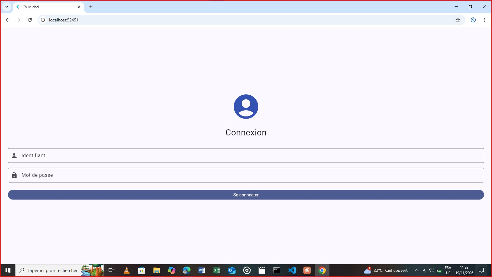
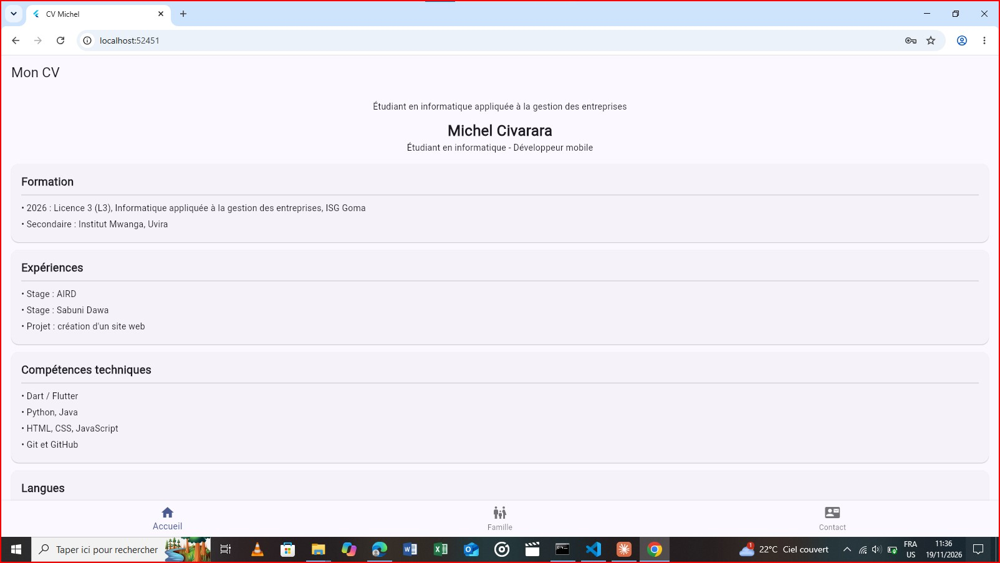
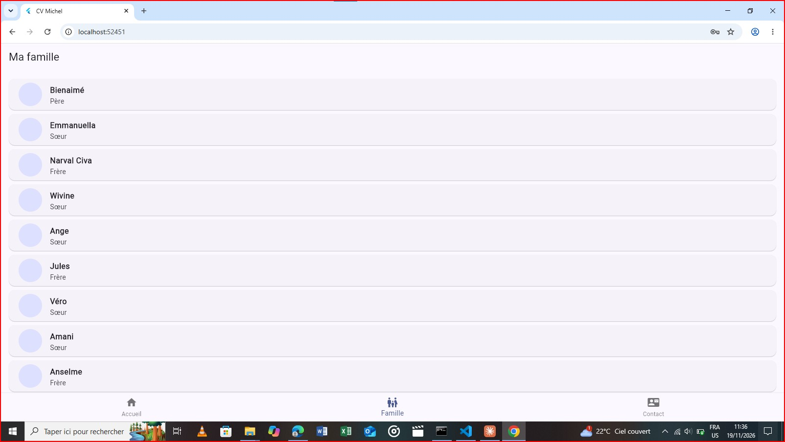
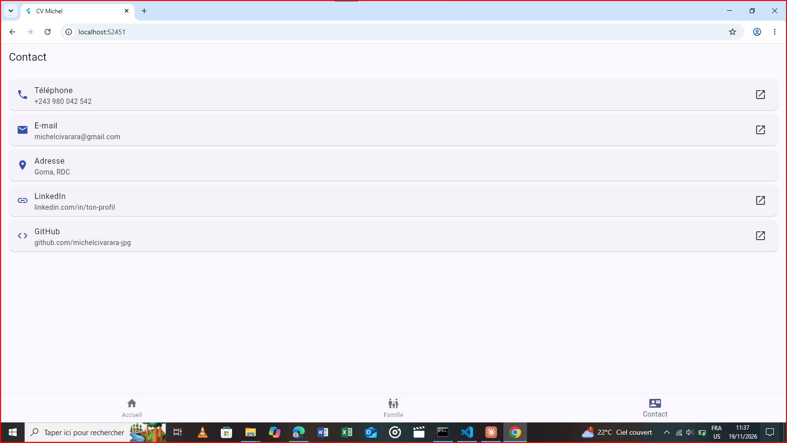

# cv_flutter_michel

Application mobile Flutter qui présente le CV, la famille et les coordonnées de Michel Civarara.

Identifiants de test : `michel` / `1234`

## Page 1 : Connexion

Formulaire avec un champ identifiant, un champ mot de passe (texte masqué) et un bouton « Se connecter ».

## Page 2 : Accueil (CV)

Photo, nom, profil, formation, expériences, compétences, langues et centres d'intérêt.

## Page 3 : Famille

Liste des membres de la famille avec leur nom, leur photo et leur lien de parenté.

## Page 4 : Contact

Téléphone, e-mail, adresse et réseaux sociaux. Les contacts sont cliquables (appel, e-mail, lien).

## Navigation

Une fois connecté, une barre de navigation en bas (BottomNavigationBar) permet de passer d'une page à l'autre.